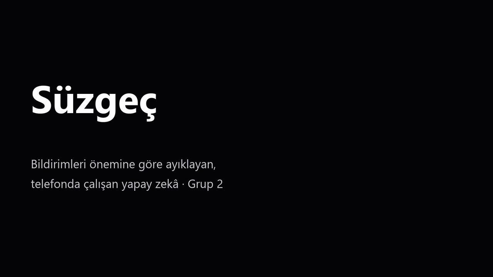
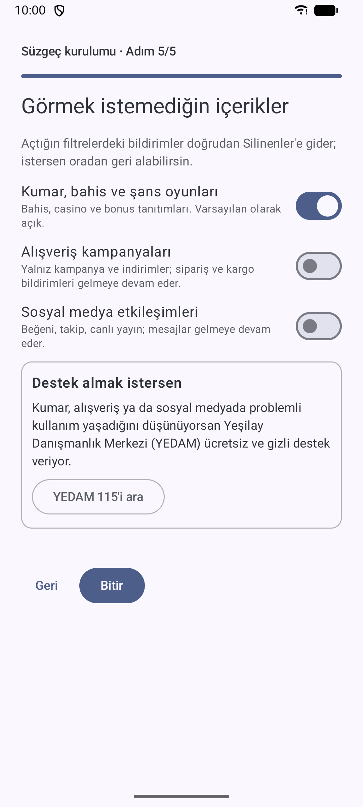
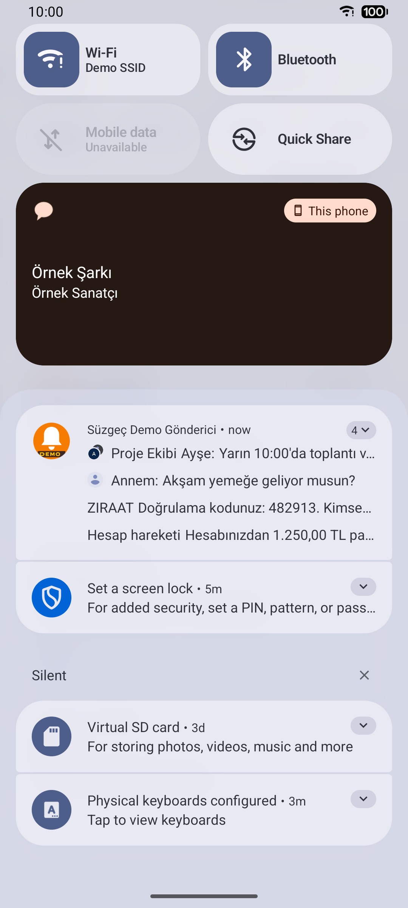
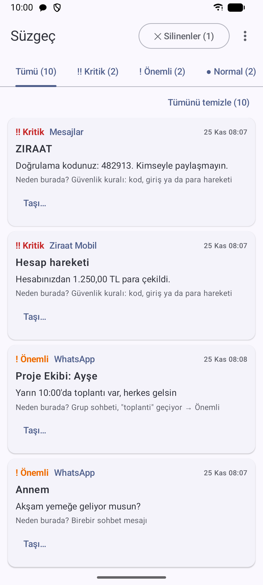
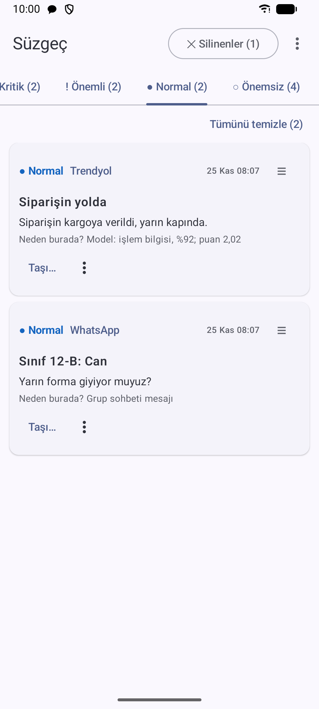
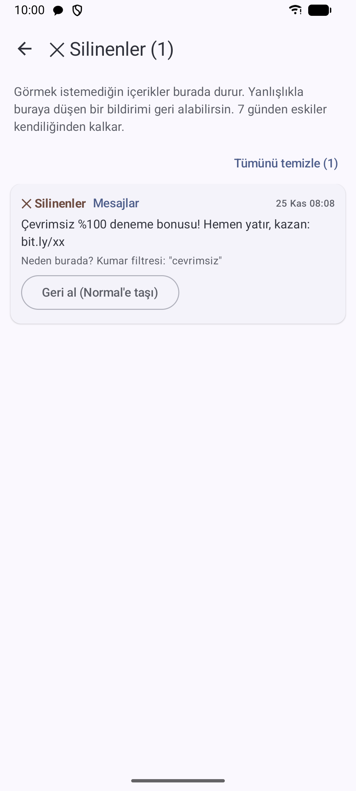
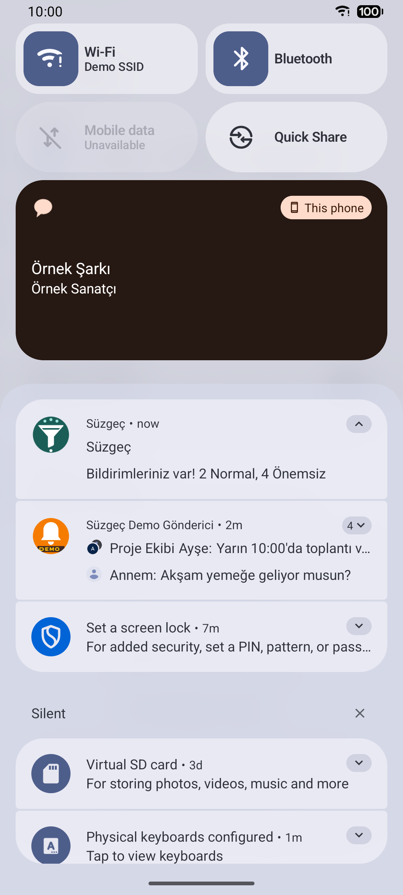
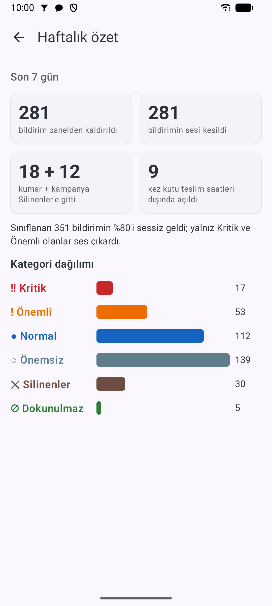
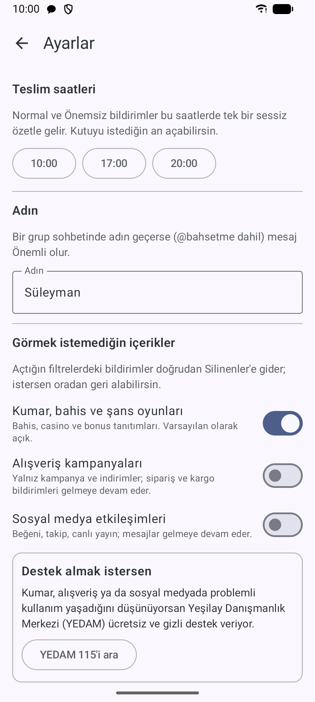

# Süzgeç · Grup 2

**Samsung Innovation Campus (SIC) AI 18 & Yeşilay — Capstone Projesi**
*Dijital bağımlılık / Digital addiction*

[Türkçe](#türkçe) · [English](#english)

---

## Türkçe

**Süzgeç**, Android telefonu sürekli "Rahatsız Etmeyin" (öncelik) modunda tutan ve gelen her bildirimi beş kategoriye ayıran bir uygulamadır:

| Kategori | Bildirim panelinde | Ses / titreşim | Süzgeç kutusunda |
|---|---|---|---|
| **Kritik** | Kalır | Süzgeç uzun çalar (~3,5 sn) | Listelenir |
| **Önemli** | Kalır | Süzgeç kısa çalar (~1 sn) | Listelenir |
| **Normal** | Kaldırılır | Yok | Günde 3 kez özetle teslim edilir |
| **Önemsiz** | Kaldırılır | Yok | Günde 3 kez özetle teslim edilir (sırada en altta) |
| **Silinenler** | Kaldırılır | Yok | Ayrı kutuda, geri alınabilir (kumar varsayılan) |

**Amaç:** FoMO'yu artırmadan telefon kontrol etme ve kilit açma sayısını azaltmak; Kritik bildirimlerin en az %95'ini kaçırmadan sesli/titreşimli uyarıları en az %50 azaltmak. Fikir, günde 3 toplu bildirim tesliminin kilit açmayı ve dikkatsizliği azalttığını gösteren Fitz ve ark. (2019) deneyinden doğdu.

**Hedef kitle:** 18 yaş üstü, üst model olmayan telefon kullanan Android kullanıcıları; öncelikle üniversite öğrencileri.

### Nasıl çalışır?

Her bildirim önce **kural katmanından**, gerekirse **metin modelinden** geçer (hepsi telefonda, internetsiz):

1. **Dokunma:** Android bayraklarıyla tanınan kalıcı/servis, arama, alarm, medya, navigasyon ve indirme bildirimleri ile sistem, saat ve acil durum uygulamaları hiç değiştirilmez.
2. **Beklemeden karar:** doğrulama kodu ve para hareketi gibi güvenlik kalıpları → Kritik; kumar sözlüğü → Silinenler (kumar mesajı panelde hiç görünmez).
3. **5 saniye bekleme:** türü anlaşılamayan bildirim 5 sn beklenir; bu sürede kendiliğinden kalkarsa yok sayılır (açık veri setlerinde bildirimlerin ~%26'sı 5 sn içinde kalkıyor).
4. **İçerik ve uygulama kuralları:** öncelikli uygulamalar (kullanıcı uygulama başına Kritik/Önemli seçer; kampanya içeriği bu seçimi geçemez), "panelde bırak", haber uygulamaları, e-postada mülakat daveti, toplu kutlama SMS'leri.
5. **Mesajlaşma:** birebir sohbet → Önemli; grup → Normal, ama grupta "toplantı / sınav / ödev / iptal / acil" ya da kullanıcının adı geçerse → Önemli.
6. **Metin modeli** (11 içerik türü) + **kategori eşlemesi** + **kişisel düzeltme**; model emin değilse bildirim en fazla Normal'e yükseltilir (güvenlik/para olasılığı ≥ %30 ise Önemli).

**Kişiselleştirme:** kullanıcının kutuda yaptığı kategori taşımaları önem puanına bir düzeltme terimi ekler, sürükleyerek sıralama ise yalnız kategori içi sırayı etkileyen ayrı bir sıra puanı öğretir:

$$\delta = \eta\,\frac{n_{\text{yukarı}} - n_{\text{aşağı}}}{n_{\text{yukarı}} + n_{\text{aşağı}} + k},\qquad k = 2,\ \eta = 1\ \text{(sıra puanında } \eta = 0{,}5\text{)}$$

Her kaydın altında **"Neden burada?"** satırı kararı veren kuralı ya da model olasılığını gösterir.

### Metin modeli

| | Değer |
|---|---|
| Model | TF-IDF (kelime sınırlı karakter 2–5 gram, 30.000 n-gram) + çok sınıflı lojistik regresyon (C = 4, sınıf ağırlıklı) |
| Eğitim verisi | 11.164 örnek: sentetik bildirimler (40 şablon ailesi), elle yazılmış bildirimler, TurkishSMSCollection ve Uysal ve ark. (2013) SMS'leri (zayıf etiketli) |
| Ön işleme | Türkçe küçük harf, bağlantı/telefon/sayı maskeleri, ASCII katlama (ş→s, ı→i…) |
| Şablon ailesi dışarıda makro F1 | 0,852 |
| Elle yazılmış bildirimler (138) | makro F1 0,903; güvenlik kuralıyla 5 kategoride 0,962, Kritik 15/15 |
| Gerçek SMS (Uysal 2013, eğitimde yok) | kampanya duyarlılığı 0,989, kampanya → kumar hatası 0/364 |
| Zor test (kumar ↔ kart kampanyası) | kumar 10/10, kampanya → kumar 0/10 |
| Telefonda | JSON (3,87 MB), Kotlin'de hesaplanır; Python ile en büyük fark 5·10⁻⁹; bildirim başına medyan 1,9 ms, en uzun 25,7 ms |

**Derin öğrenme karşılaştırması:** küçük Türkçe BERT (turkish-mini-bert, 11,6 M parametre) temiz bildirim metninde biraz daha iyi (makro F1 0,917 / 0,897) ama gerçek SMS'lerde belirgin biçimde geride (0,339 / 0,530; güvenlik duyarlılığı 0,05 / 0,58), 12 kat büyük (46,2 MB) ve ~5 kat yavaş. Bu yüzden uygulamada TF-IDF + LR kullanıldı.

### Gerçek telefonda sonuç

Süzgeç 1.0, bir ekip üyesinin kişisel telefonunda (Samsung Galaxy M51, Android 12) günlük kullanımda denendi (26,9 saat):

| Ölçüt | Sonuç |
|---|---|
| Kaydedilen bildirim / farklı uygulama | 104 / 26 |
| Sınıflanan (dokunulmazlar hariç) | 69 |
| Ses ve titreşim olmadan teslime ya da Silinenler'e giden | **%56,5** (hedef ≥ %50) |
| Kararı kural katmanı verdi / model verdi | %43,5 / %56,5 |
| Sesli, titreşimli, sessiz mod; duraklatma; yeniden başlatma; alarm ve arama | Hepsi doğru çalıştı |
| Günde 3 teslim | 3/3 (10 dk pencere içinde) |
| Arkadaşlardan gelen gerçek kumar mesajları (SMS ve WhatsApp) | Silinenler'e gitti; kumar olmayan kontrol mesajlarında yanlış alarm yok |

Gerçek kullanımda bulunan hatalar (ör. haber bildirimlerinin titretmesi, bir doğrulama kodunun Önemli gelmesi) kural düzeltmelerine dönüştü. Ayrıntı ve sınırlılıklar: 5. ödev ve [`docs/bilinen_sinirlar.md`](docs/bilinen_sinirlar.md).

### Planlanan → gerçekleşen

| Konu | Plan (1–3. ödev) | Gerçekleşen (Süzgeç 1.0) | Neden |
|---|---|---|---|
| Ana metin modeli | turkish-mini-bert (LiteRT) | TF-IDF + LR (JSON + Kotlin) | Gerçek SMS'te daha iyi, 12 kat küçük, ~5 kat hızlı (5. ödev, 3.3) |
| Bağlam bilgisi | Puan formülünde ağırlıklı terim | Kural katmanı (Android bayrakları, sohbet türü, uygulama listeleri) | Kesin bilinen durumda modele karar bırakılmadı; kararların %43,5'i kuraldan |
| Sıralama öğrenmesi | LightGBM sıralama modeli | Sürükleme çiftlerinden sıra puanı | Az veride basit, anında etkili ve geri alınabilir |
| SMS/e-posta uygulamasından silme (2. aşama) | Bildirim eylem butonlarıyla | 1.0'da yok; deneysel emülatör demosu var | Kişisel telefonda başka uygulamanın verisine dokunmamak için 1.0'a alınmadı; kullanıcı onaylı silme, sahte gelen kutusuyla emülatörde gösterildi ([`release/deneysel_emulator_silme/`](release/deneysel_emulator_silme/README.md)) |
| Ekran süresi, geçiş analizi, süre sınırı (3. aşama) | Sonraki aşama | Yapılmadı | Kapsam: demo 1. aşama |

### Teslim dosyaları / Deliverables

| # | Ödev / Assignment | English | Türkçe |
|---|---|---|---|
| 1 | Idea Proposal / Fikir Önerisi | [PDF](deliverables/01_Idea_Proposal/Suzgec_Group2_Idea_Proposal_EN.pdf) · [Word](deliverables/01_Idea_Proposal/Suzgec_Group2_Idea_Proposal_EN.docx) | [PDF](deliverables/01_Idea_Proposal/Suzgec_Grup2_Fikir_Onerisi_TR.pdf) · [Word](deliverables/01_Idea_Proposal/Suzgec_Grup2_Fikir_Onerisi_TR.docx) |
| 2 | Literature, Data & Technology Review / Literatür, Veri ve Teknoloji İncelemesi | [PDF](deliverables/02_Literature_Data_Technology_Review/Suzgec_Group2_Literature_Data_Technology_Review_EN.pdf) · [Word](deliverables/02_Literature_Data_Technology_Review/Suzgec_Group2_Literature_Data_Technology_Review_EN.docx) | [PDF](deliverables/02_Literature_Data_Technology_Review/Suzgec_Group2_Literatur_Veri_Teknoloji_Incelemesi_TR.pdf) · [Word](deliverables/02_Literature_Data_Technology_Review/Suzgec_Grup2_Literatur_Veri_Teknoloji_Incelemesi_TR.docx) |
| 3 | Concept Note & Implementation Plan / Kavram Notu ve Uygulama Planı | [PDF](deliverables/03_Concept_Note_Implementation_Plan/Suzgec_Grup2_Concept_Note_Implementation_Plan_EN.pdf) · [Word](deliverables/03_Concept_Note_Implementation_Plan/Suzgec_Grup2_Concept_Note_Implementation_Plan_EN.docx) | [PDF](deliverables/03_Concept_Note_Implementation_Plan/Suzgec_Grup2_Concept_Note_ve_Uygulama_Plani_TR.pdf) · [Word](deliverables/03_Concept_Note_Implementation_Plan/Suzgec_Grup2_Concept_Note_ve_Uygulama_Plani_TR.docx) |
| 4 | Data Preparation, Feature Engineering & Model Exploration / Veri Hazırlama, Öznitelik Mühendisliği ve Model Keşfi | [PDF](deliverables/04_Data_Preparation_Feature_Engineering_Model_Exploration/Suzgec_Group2_Data_Preparation_and_Model_Exploration_EN.pdf) · [Word](deliverables/04_Data_Preparation_Feature_Engineering_Model_Exploration/Suzgec_Group2_Data_Preparation_and_Model_Exploration_EN.docx) | [PDF](deliverables/04_Data_Preparation_Feature_Engineering_Model_Exploration/Suzgec_Grup2_Veri_Hazirlama_ve_Model_Kesfi_TR.pdf) · [Word](deliverables/04_Data_Preparation_Feature_Engineering_Model_Exploration/Suzgec_Grup2_Veri_Hazirlama_ve_Model_Kesfi_TR.docx) |
| 5 | Model Refinement & Testing / Model İyileştirme ve Test | [PDF](deliverables/05_Model_Refinement_Testing/Suzgec_Group2_Model_Refinement_and_Testing_EN.pdf) · [Word](deliverables/05_Model_Refinement_Testing/Suzgec_Group2_Model_Refinement_and_Testing_EN.docx) | [PDF](deliverables/05_Model_Refinement_Testing/Suzgec_Grup2_Model_Iyilestirme_ve_Test_TR.pdf) · [Word](deliverables/05_Model_Refinement_Testing/Suzgec_Grup2_Model_Iyilestirme_ve_Test_TR.docx) |
| 6 | Final sunumu / Final presentation | [PDF](deliverables/06_Final_Presentation/Suzgec_Grup2_Final_Sunum.pdf) | |
| 7 | Demo videosu / Demo video (3:12) | <a href="https://youtu.be/rKRlmqLBZEY"></a><br>[YouTube · English](https://youtu.be/rKRlmqLBZEY) | <a href="https://youtu.be/Eu482-Sd8X8"></a><br>[YouTube · Türkçe](https://youtu.be/Eu482-Sd8X8) |

### Ekran görüntüleri / Screenshots

Android emülatöründe, demo göndericinin sahte bildirimleriyle alındı (gerçek kullanıcı verisi yok).

|  |  |  |  |
|:---:|:---:|:---:|:---:|
| Sihirbaz: görmek istemediğin içerikler | Kritik ve Önemli panelde kalır | Kutu: önem sırasına göre | "Neden burada?" satırı |
|  |  |  |  |
| Silinenler: kumar, geri alınabilir | Günde 3 sessiz teslim özeti | Haftalık özet (örnek veri) | Ayarlar: saatler ve filtreler |

### Uygulamayı kurmak ve denemek

- **Hazır APK:** [`release/Suzgec-1.0.apk`](release/Suzgec-1.0.apk) (imzalı sürüm, Android 8.0+). Telefonda "bilinmeyen kaynaklardan yükleme" izni gerekir.
- **Deneysel silme demosu (yalnız emülatör):** [`release/deneysel_emulator_silme/`](release/deneysel_emulator_silme/README.md). Kullanıcı onayıyla kumar mesajını gönderen uygulamanın kutusundan da silen ayrı bir debug derleme; yalnız kendi sahte gelen kutusuyla çalışır, SMS izni yoktur. Uyarılar, kurulum adımları ve kaynak kodu o klasörde.
- **Kurulum sihirbazı** sırasıyla bildirim erişimi, Rahatsız Etmeyin erişimi ve pil optimizasyonu muafiyeti ister; teslim saatlerini ve görmek istemediğin içerikleri (kumar varsayılan açık) seçtirir. Samsung telefonlarda Süzgeç'in pil ayarı "Kısıtlanmamış" olmalıdır.
- **Duraklat:** Ayarlar'daki "Süzgeç'i duraklat" telefonun önceki ses ve Rahatsız Etmeyin ayarını geri yükler.
- **Kaynaktan derleme:** Android Studio ile `app/` modülünü açın; `gradlew assembleDebug`. Testler: `gradlew :app:testDebugUnitTest` (103 birim testi; Python–Kotlin model eşliği dahil).
- **Demo gönderici (`sender/`):** demo senaryosundaki 31 sahte bildirimi gönderir ([`docs/demo_senaryosu.md`](docs/demo_senaryosu.md)). Uygulama adı taklidi yalnız debug derlemede çalışır.
- **Model yeniden eğitimi (`ml/`):** `pip install -r requirements.txt` → `python sentetik_uret.py` → `python egit.py`; çıktı `model_tfidf_lr.json` → `app/src/main/assets/`.

### Depo yapısı / Repository layout

```
.
├── README.md
├── deliverables/        # 1–5. ödevler (EN + TR, PDF + Word), final sunumu
├── app/                 # Android uygulaması (Kotlin, Jetpack Compose, Room)
├── sender/              # Demo bildirim gönderici
├── ml/                  # Sentetik veri, eğitim, değerlendirme, JSON dışa aktarma (Python)
├── docs/                # Demo senaryosu, demo sonuçları, bilinen sınırlar
└── release/             # İmzalı Süzgeç 1.0 APK; deneysel_emulator_silme/ (yalnız emülatör demosu)
```
Geliştirici belgesi (modüller, karar akışı, veri modeli, model, testler): [`docs/mimari.md`](docs/mimari.md)
Sürüm notları (0.1 → 1.0): [`docs/surum_notlari.md`](docs/surum_notlari.md)

### Veri ve gizlilik / Data and privacy

- Bütün sınıflandırma telefonda yapılır; bildirim metni telefondan çıkmaz. Gönderen kimliği SHA-256 karmasıyla saklanır; "Verileri dışa aktar" CSV'si bildirim metni ve başlığı içermez.
- Süzgeç 1.0 başka uygulamaların içinde hiçbir şeyi silmez; yalnız bildirimi panelden kaldırır ve kendi kayıtlarını tutar. (Deneysel emülatör derlemesi yalnız kendi demo gönderici uygulamasının sahte kutusunu siler.)
- Belgelerdeki gerçek kullanım sonuçları yalnız toplu sayılardır; kişi adı, mesaj metni ya da gönderen kurum adı yer almaz. Örnekler demo senaryosundaki sahte bildirimlerdir.
- Üçüncü taraf veri setleri (TurkishSMSCollection, Uysal ve ark. 2013, Komninos ve ark.) bu depoya eklenmemiştir; kaynakları ve lisansları 2. ödevin Part 2 bölümündedir.

### Ekip / Team

| Üye / Member |
|---|
| Süleyman Yalım |
| Sinem Can |
| Nimet Nisa Silav |
| Mehmet Ali Kuruçay |
| Muhammed Hamza Orak |

Destek: Yeşilay Danışmanlık Merkezi (YEDAM) **115**.

---

## English

**Süzgeç** (Turkish for "filter") keeps an Android phone in Do Not Disturb (priority) mode and sorts every incoming notification into five categories. **Critical** and **Important** notifications stay in the notification shade and Süzgeç plays its own long or short alert; **Normal** and **Unimportant** ones are removed from the shade and delivered silently as a summary three times a day at times the user chooses; content the user does not want to see (**gambling** by default, optionally shopping promotions and social media) goes to a separate, restorable **Deleted** box.

**Goal:** reduce phone checks and unlocks without increasing FoMO; cut sound/vibration alerts by at least 50% while delivering at least 95% of Critical notifications. Inspired by Fitz et al. (2019), where batching notifications three times a day reduced inattention and unlocks.

**How it works (fully on-device):** a rule layer first (Android flags, security codes and gambling decided without waiting, a 5-second wait for ambiguous notifications, priority apps, chat type: one-to-one → Important, group → Normal unless it mentions a meeting, exam or the user's name), then a text model for everything else. The model is **TF-IDF (char 2–5 grams) + logistic regression** over 11 content types, exported to JSON and computed in Kotlin (3.87 MB; median 1.9 ms per notification; max difference from Python 5·10⁻⁹). Users teach Süzgeç by moving notifications between categories (a correction term on the importance score) and by dragging to reorder (a separate within-category order score). Every item shows a **"Why is this here?"** line.

**Results:** template-family-out macro F1 0.852; hand-written notifications macro F1 0.903 (0.962 over 5 categories with the security rule, Critical 15/15); real SMS (Uysal 2013, unseen) campaign recall 0.989 with 0/364 campaigns mistaken for gambling. A small Turkish BERT was slightly better on clean text but clearly worse on real SMS, 12× larger and ~5× slower, so the app ships the linear model. On a real phone (Galaxy M51, Android 12, 26.9 h of daily use) Süzgeç classified 69 notifications and silenced **56.5%** of them (target ≥ 50%); the rule layer decided 43.5%; all sound-mode, pause, reboot, alarm and call checks passed, and real gambling messages from friends were removed with no false alarms on control messages.

**Planned → delivered:** turkish-mini-bert → TF-IDF + LR (better on real SMS, smaller, faster); context term → rule layer; LightGBM ranking → drag-pair order score; deleting messages inside SMS/e-mail apps is not in 1.0 (shown only as an opt-in, emulator-only experimental build with a fake inbox: [`release/deneysel_emulator_silme/`](release/deneysel_emulator_silme/README.md)); the stage-3 wellbeing features (screen time, app-transition analysis, usage limits) were not built in this version.

**Install:** [`release/Suzgec-1.0.apk`](release/Suzgec-1.0.apk) (signed, Android 8.0+). The setup wizard asks for notification access, Do Not Disturb access and a battery-optimisation exemption. Build from source with Android Studio (`gradlew assembleDebug`); run tests with `gradlew :app:testDebugUnitTest` (103 unit tests). Retrain the model in `ml/`. Experimental emulator-only deletion demo: [`release/deneysel_emulator_silme/`](release/deneysel_emulator_silme/README.md).

**Privacy:** all processing is on the phone; notification text never leaves it; senders are stored as SHA-256 hashes; the CSV export contains no notification text. Süzgeç 1.0 never deletes anything inside other apps (the experimental emulator build only clears its own demo sender's fake inbox). Real-use results in the documents are aggregate counts only. Third-party datasets are not redistributed (sources and licences: deliverable 2, Part 2).

Support: Yeşilay Counselling Centre (YEDAM) **115**.

## Ana kaynak / Main source

Fitz, N., Kushlev, K., Jagannathan, R., Lewis, T., Paliwal, D., & Ariely, D. (2019). Batching smartphone notifications can improve well-being. *Computers in Human Behavior, 101*, 84–94. https://doi.org/10.1016/j.chb.2019.07.016
